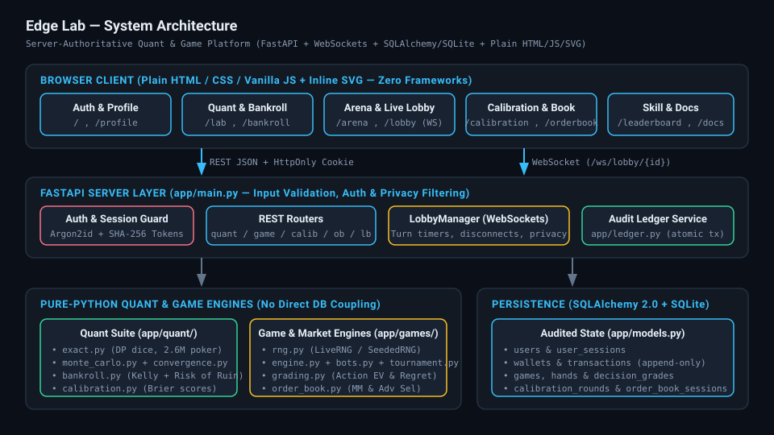
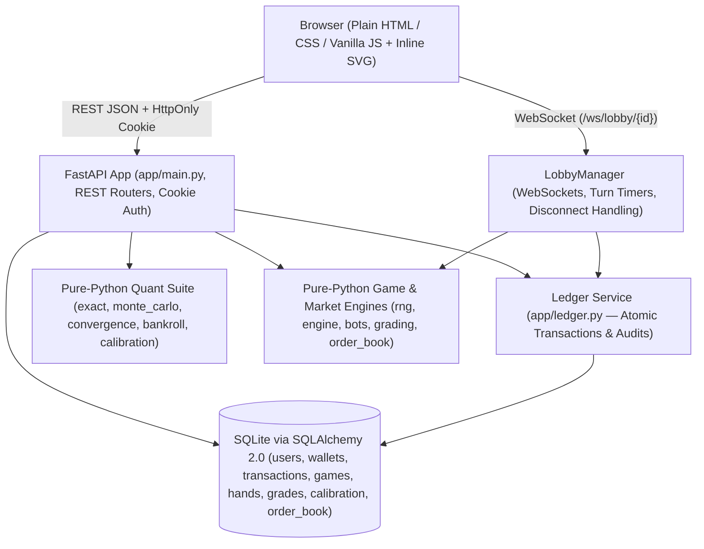
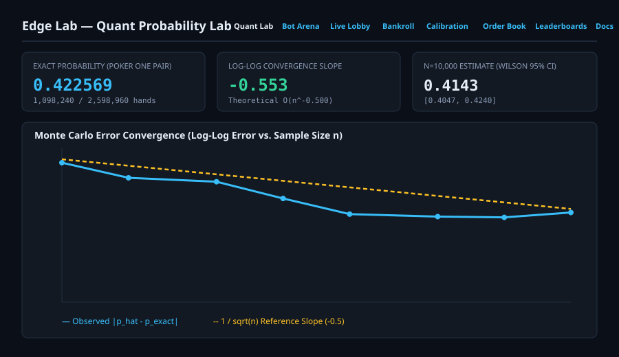
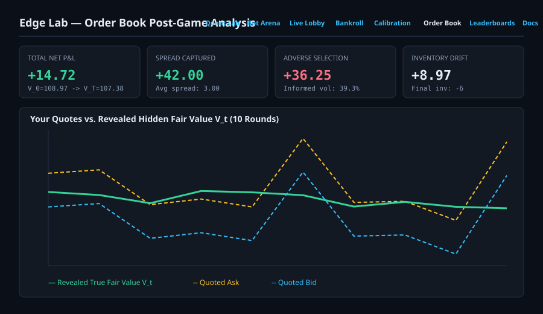

# Edge Lab

**Edge Lab** is a virtual-coin quantitative finance and decision-grading game platform (**no real money**). Players compete head-to-head against other players and algorithmic bots in probability games, practice probability calibration, simulate Kelly bankroll growth and risk of ruin, and quote two-sided markets in an order book simulator—while the server grades every decision using exact probability, Expected Value (EV), and regret.

> **Disclaimer**: Edge Lab uses virtual coins (`1,000` starting coins per account) strictly for educational and quantitative portfolio demonstration. There is no real currency, wagering, or financial custody.

---

## What It Shows

| Module | Route | What You Can Do |
|---|---|---|
| **Auth & Auditable Wallet** | `/`, `/profile` | Register/login with Argon2id passwords & `HttpOnly` sessions; audit `1,000`-coin starting wallets against an append-only `Transaction` ledger. |
| **Exact & Monte Carlo Lab** | `/lab` | Compare DP dice sums, exact 5-card poker counts (`2,598,960`), Hypergeometric draws, and Birthday collisions against seeded Monte Carlo with Wilson 95% CIs, log-log $1/\sqrt{n}$ convergence, and empirical CI coverage tests. |
| **Bot Arena & Game Engine** | `/arena` | Run reproducible round-robin tournaments across 4 strategies (`RandomBot`, `CautiousBot`, `EVMaximisingBot`, `KellySizingBot`) in Heads-Up Dice Betting and 1-Card Poker. |
| **Real-Time WebSocket Lobby** | `/lobby` | Join 2-player or player-vs-bot tables over WebSockets with atomic coin settlements, 30s turn timers, disconnect forfeitures, and strict hidden-card privacy. |
| **Decision EV Grading & Leaderboards** | `/leaderboard`, `/skill-vs-luck` | Inspect post-game action EV and regret ($\text{Best EV} - \text{Taken EV}$), comparing the **Skill Leaderboard (Cumulative EV)** against the **Coins Leaderboard (Luck + Skill)**. |
| **Bankroll Simulator** | `/bankroll` | Compute full/half-Kelly fractions, log-wealth growth $g(f)$, closed-form Gambler's Ruin, P10/Median/P90 Monte Carlo trajectory fans, and terminal outcome histograms. |
| **Probability Calibration** | `/calibration` | Estimate probabilities for server-generated quant puzzles and track Brier scores $(\hat{p}-y)^2$ and 5-bin reliability curves over time. |
| **Order Book Market Making** | `/orderbook` | Quote `bid`, `ask`, and `size` around an evolving hidden fair value; face noise, retail, and informed arbitrage bots; audit spread capture vs. adverse selection and inventory drift. |
| **Algorithm Guide & OpenAPI** | `/docs`, `/api/docs` | Plain-language explanation of every algorithm (`docs/index.html` & `docs/algorithms.md`) plus interactive OpenAPI docs at `/api/docs`. |

---

## Architecture Diagram





---

## Screenshots

Generated directly from Edge Lab's `SeededRNG` quant and market engines:

### 1. Quant Convergence Lab (`/lab`)


### 2. Bankroll, Kelly Criterion & Risk of Ruin (`/bankroll`)


### 3. Order Book Market Making & Adverse Selection (`/orderbook`)


---

## How to Run

### Prerequisites
- **Python 3.11+** (also compatible with Python `3.10.12`; CI tests `3.11` and `3.12`)
- `git`

### Setup & Start

```bash
# 1. Clone and create a virtual environment
python -m venv .venv
source .venv/bin/activate

# 2. Install dependencies
pip install --upgrade pip
pip install -r requirements.txt

# 3. Start the FastAPI server
uvicorn app.main:app --host 0.0.0.0 --port 8000 --reload
```

Open **`http://127.0.0.1:8000/`** in your browser (or visit `/docs` for the plain-language algorithm guide and `/health` for the JSON readiness probe).

### Environment Variables

All runtime settings in `app/config.py` default to sensible local values and can be overridden via `EDGE_LAB_*` environment variables:

- `EDGE_LAB_DATABASE_URL` (default: `sqlite:///./edge_lab.db`)
- `EDGE_LAB_INITIAL_WALLET_BALANCE` (default: `1000`)
- `EDGE_LAB_SESSION_TTL_SECONDS` (default: `604800`, 7 days)
- `EDGE_LAB_COOKIE_SECURE` (default: `false`; set `true` behind HTTPS)
- `EDGE_LAB_TURN_TIMEOUT_SECONDS` (default: `30.0`)

### Run Tests & Linters

```bash
ruff check app tests
pytest -v --cov=app --cov-report=term-missing
```

---

## The Maths Used

### 1. Exact Combinatorics & Dynamic Programming (`app/quant/exact.py`)
- **Dice Sum Distribution**: Bottom-up dynamic programming transition $dp_{t+1}[s + f] \mathrel{+}= dp_t[s]$ for $f \in \{1,\dots,m\}$, computing exact probabilities in $O(d \cdot s_{\max} \cdot m)$ instead of $m^d$.
- **5-Card Poker Counts**: Exact mutually exclusive counting partitioning all $\binom{52}{5} = 2,598,960$ hands across all 10 tiers.
- **Hypergeometric PMF**: Sampling without replacement:
  $$P(X = k) = \frac{\binom{K}{k}\binom{N-K}{n-k}}{\binom{N}{n}}$$
- **Birthday Collision**:
  $$P(\text{collision}) = 1 - \prod_{i=0}^{m-1} \frac{D - i}{D}$$

### 2. Monte Carlo, Wilson 95% CI & $O(1/\sqrt{n})$ Convergence (`app/quant/monte_carlo.py`, `convergence.py`)
- **Wilson Score Interval** (bounded strictly inside $[0, 1]$, avoiding Wald boundary collapse):
  $$\frac{\hat{p} + \frac{z^2}{2n} \pm z\sqrt{\frac{\hat{p}(1-\hat{p})}{n} + \frac{z^2}{4n^2}}}{1 + \frac{z^2}{n}}, \quad z \approx 1.96$$
- **Convergence Rate**: Ordinary least-squares regression on $(\log_{10} n, \log_{10} |\hat{p}_n - p|)$ verifies the theoretical $-0.5$ slope of $O(1/\sqrt{n})$.

### 3. Action Expected Value & Decision Regret (`app/games/grading.py`)
Evaluated relative to the decision point (prior pot chips are sunk):
- $\text{EV}(\text{FOLD}) = 0$
- $\text{EV}(\text{CHECK}) = q \cdot P$
- $\text{EV}(\text{CALL}) = q \cdot (P + c) - c$
- $\text{EV}(\text{BET } b)$: Exact expectation over the remaining deck/die assuming a rational opponent calls iff their equity exceeds pot odds $b / (P + 2b)$:
  $$\text{Regret} = \max_{a \in \mathcal{A}_{\text{legal}}} \text{EV}(a) - \text{EV}(a_{\text{taken}}) \ge 0$$

### 4. Kelly Criterion & Risk of Ruin (`app/quant/bankroll.py`)
- **Optimal Kelly Fraction** for win probability $p$ and net odds $b$:
  $$f^* = \max\!\left(0,\; p - \frac{1 - p}{b}\right)$$
- **Expected Log-Wealth Growth**:
  $$g(f) = p \ln(1 + b f) + (1 - p)\ln(1 - f)$$
- **Closed-Form Gambler's Ruin** (fixed even-money unit bets, $b=1$, starting from $k$ units):
  $$P(\text{ruin}) = \begin{cases} 1, & p \le \frac{1}{2} \\ \left(\frac{1-p}{p}\right)^k, & p > \frac{1}{2} \end{cases}$$

### 5. Calibration & Brier Score (`app/quant/calibration.py`)
Strictly proper quadratic scoring rule for forecast $\hat{p} \in [0, 1]$ and realized outcome $y \in \{0, 1\}$:
$$\text{BS} = (\hat{p} - y)^2$$

### 6. Order Book Market Making Decomposition (`app/games/order_book.py`)
For each fill $i$ of quantity $q_i$ with direction $d_i = +1$ (user buys on bid) or $d_i = -1$ (user sells on ask) at quoted midpoint $m_i$ and half-spread $h_i = (\text{ask}_i - \text{bid}_i)/2$:
$$\text{Total MTM P\&L} = \underbrace{\sum_i q_i h_i}_{\text{Spread Captured}} - \underbrace{\sum_i q_i d_i (m_i - V_{t(i)})}_{\text{Adverse Selection Cost}} + \underbrace{\sum_{t=1}^{T} Q_{t-1}(V_t - V_{t-1})}_{\text{Inventory Drift P\&L}}$$

---

## Limitations

1. **Single-Process WebSocket & SQLite Concurrency**: `LobbyManager` keeps active lobby/table states in Python memory, and SQLite serializes writes. Scaling across multiple processes or workers requires moving lobby state to Redis/pub-sub and switching SQLite to PostgreSQL.
2. **Simplified Single-Street Game Tree**: Heads-up Dice Betting and 1-Card Poker cap betting to one street without multi-street raises. Likewise, `EVMaximisingBot` and `grading.py` model opponent calling decisions with a pot-odds threshold rather than solving full Nash equilibrium mixed strategies.
3. **Synthetic Order Book Microstructure**: The order book simulator clears discrete rounds against three stylized bot flows (`informed_arb`, `noise_trader`, `retail_flow`). It does not simulate continuous-time order queues, FIFO price-time priority, latency arbitrage races, or partial tick-level order cancellations.
4. **No Built-In Rate Limiting**: Authentication and compute-heavy Monte Carlo endpoints validate input bounds via Pydantic, but rely on an upstream reverse proxy for IP rate limiting in public deployments.
5. **Educational Virtual Economy Only**: No real-money rails, KYC, or regulatory controls exist.

---

## Documentation & Governance

- **[Plain-Language Algorithm Guide](docs/algorithms.md)** (also served interactively at `/docs`)
- **[Security Note](SECURITY.md)** — Authentication, cryptographic RNG, privacy filtering, and ledger audit guarantees
- **[Contributing Guide](CONTRIBUTING.md)** — Repository layout, coding conventions, and test commands
- **[MIT License](LICENSE)**
